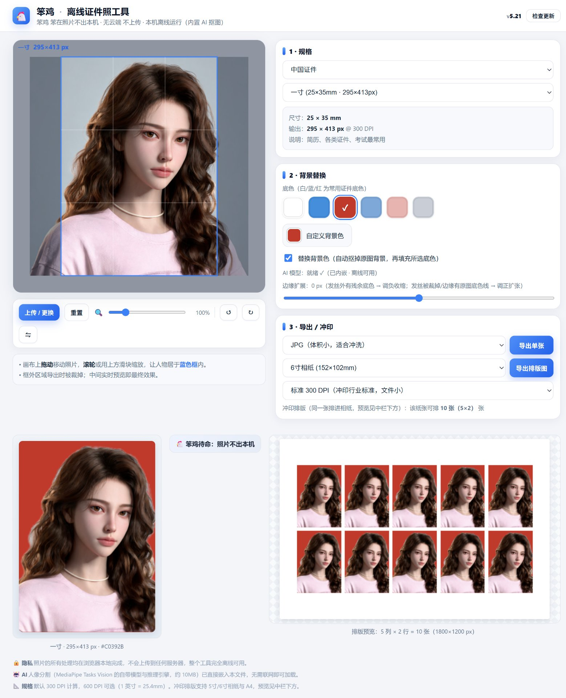
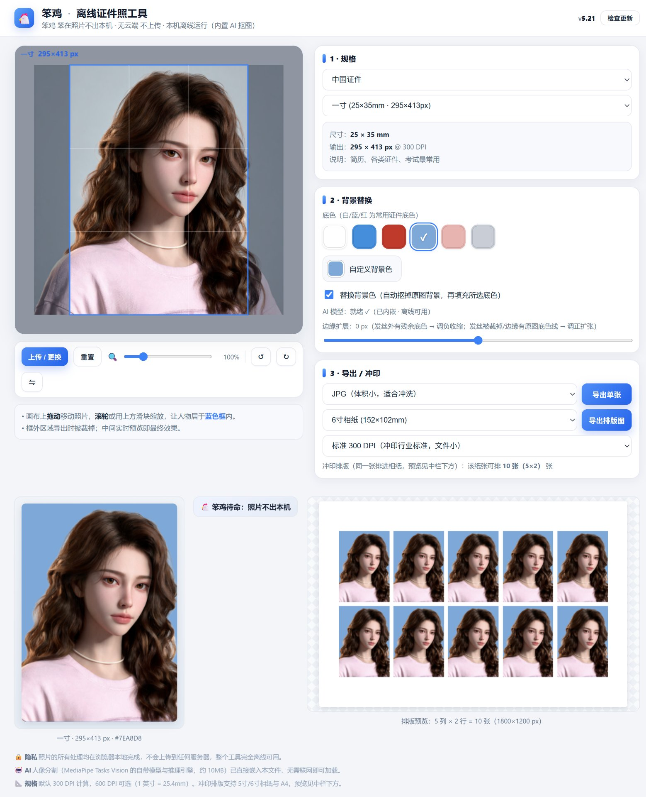
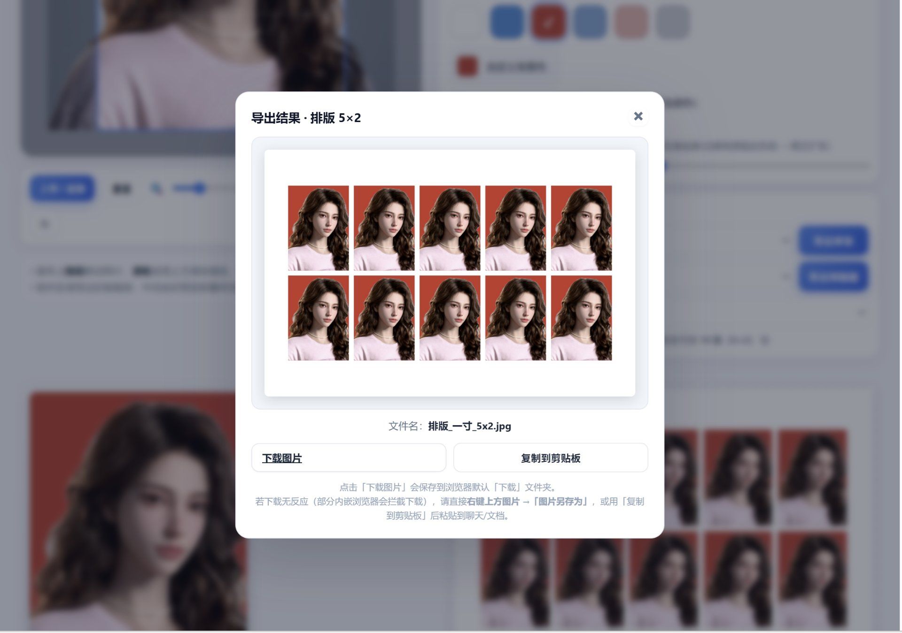

# 笨鸡离线证件照工具 · 软件说明书
（计算机软件著作权登记用 · 用户操作手册）

软件名称：笨鸡离线证件照工具
版本号：V5.21
著作权人：周文馨

---

## 一、软件概述
笨鸡离线证件照工具是一款纯前端、完全离线运行的证件照制作软件。它将 AI 人像分割、尺寸裁切、底色替换、相纸排版等功能集成在单个 HTML 文件中，用户用浏览器打开即可使用，无需安装、无需联网、无需上传照片。

核心特点：
- 离线可用：AI 模型已打包在文件内，断网也能抠图；
- 隐私优先：照片全程在本地浏览器处理，不上传任何服务器；
- 标准尺寸：覆盖中国证件、美国证件、国际签证等区域的常用规格；
- 一键导出：单张导出或相纸排版导出，支持 300 DPI / 600 DPI。

## 二、运行环境
- 硬件：任何带显示器与鼠标 / 触控板的个人计算机；
- 软件：Chrome / Edge / Firefox 等较新版本浏览器；
- 依赖：浏览器需支持 WebGL（AI 抠图依赖）；
- 系统：Windows / macOS / Linux 均可，浏览器跨平台。

## 三、安装与启动
本软件为单一 HTML 文件（笨鸡离线证件照工具.html），无安装过程：
1. 获取文件（见「检查更新」或 GitHub Releases）；
2. 用鼠标双击该 HTML 文件，默认浏览器即会打开；
3. 页面加载完成后即可使用，无需任何配置。

## 四、功能模块与操作说明

### 4.1 上传照片
- 点击左侧「上传图片」按钮，或把照片文件直接拖入左侧画布区域；
- 支持常见图片格式（JPG / PNG 等）。

### 4.2 调整取景
- 在画布上拖动以移动人物位置；
- 使用滚轮或上方滑块缩放，使人物居中于蓝色取景框内；
- 蓝框外区域在导出时会被裁掉，中间实时预览即最终效果。

【图1】主界面（上传 / 取景 / 规格选择，图中为红底效果）：

### 4.3 选择规格与底色
- 「区域」选择：中国证件 / 美国证件 / 国际·签证；
- 「规格」选择目标尺寸（一寸、二寸、护照、签证等）；
- 换底色：点击色块选择 白 / 蓝 / 红 / 淡蓝 / 粉 / 灰，或「自定义背景色」任选；
- 勾选「替换背景色」启用 AI 抠图换底；发丝边缘残留可用「边缘扩展」微调。

【图2】换底色效果（同一界面将底色切换为蓝色，展示 AI 抠图换底）：

### 4.4 导出
- 导出单张：按所选规格输出，分辨率可选 300 DPI（标准）或 600 DPI（高清）；
- 导出排版图：同一张排进 5 寸 / 6 寸 / A4 相纸，中栏下方有预览，便于送冲印店。

【图3】导出与相纸排版预览（「导出结果 · 排版 5×2」对话框）：

### 4.5 检查更新
- 页面右上角（版本号旁）有「检查更新」按钮；点击后自动比对服务器版本；
- 若为最新则提示「已是最新版本」；若有新版本则提示下载，确认后浏览器自动下载新文件；
- 用户用新文件覆盖旧文件即可升级。

## 五、技术特点
- 前端单文件架构：HTML + CSS + JavaScript 全部内联，便于分发与离线使用；
- 内嵌 AI 模型：采用 MediaPipe Tasks Vision 图像分割模型（Apache-2.0，Google LLC），模型权重以二进制形式打包于文件内，无需联网调用；
- 本地化处理：所有图像运算在浏览器端完成，保障用户隐私；
- 高 DPI 输出：严格按 300 DPI / 600 DPI 计算像素尺寸，符合冲印行业标准。

## 六、第三方组件声明
本软件包含 Google LLC 提供的 MediaPipe Tasks Vision 开源组件，采用 Apache License 2.0。该组件著作权归 Google LLC 所有，本登记仅主张软件整体的独创性表达与编排，不包含对上述第三方组件的著作权主张。

## 七、界面截图说明
本说明书第四部分已嵌入以下真实运行界面截图：
- 图1：主界面（上传 / 取景 / 规格选择，红底效果）；
- 图2：换底色效果（同一界面切换为蓝底，展示 AI 抠图换底对比）；
- 图3：导出与相纸排版预览（「导出结果 · 排版 5×2」对话框）。

---
© 2026 周文馨，保留权利。个人非商用免费，禁未授权商用 / 再分发。
